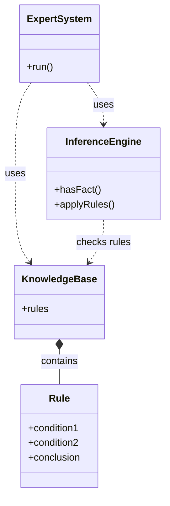

# Rule-Based Decision Support System

A rule-based Expert System developed in C++ that accepts user-entered symptoms and derives possible conclusions using predefined rules.

## Objectives

- Understand rule-based expert systems.
- Represent knowledge using predefined rules.
- Apply forward chaining to derive conclusions.
- Demonstrate object-oriented programming in C++.

## Technologies Used

- C++
- Classes and objects
- Constructors
- Arrays
- Loops and conditional statements

## Class Diagram



## Working

1. The user enters symptoms.
2. The system stores them as facts.
3. The inference engine checks the predefined rules.
4. Matching rules produce new facts.
5. The process repeats until no new conclusions can be derived.

## Sample Input

- `fever`
- `cough`
- `body_ache`

## Sample Output

```text
flu
viral_infection
```

## How to Run

Compile the program:

```bash
g++ main.cpp -o main.exe
```

Run the program on Windows:

```powershell
.\main.exe
```

## Limitations

The system uses a limited set of predefined rules. Its medical examples are for educational demonstration only and are not intended for actual medical diagnosis.
